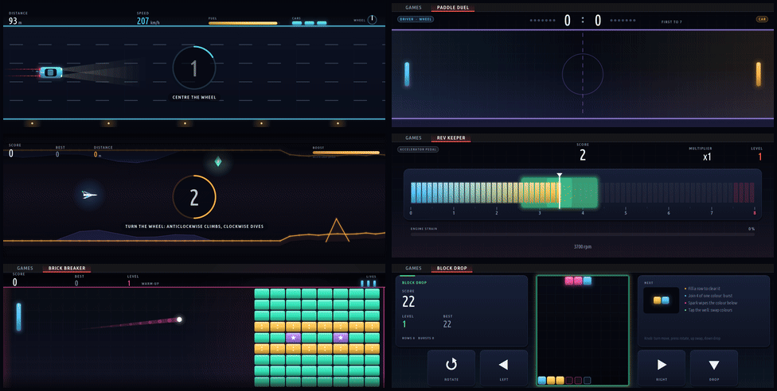
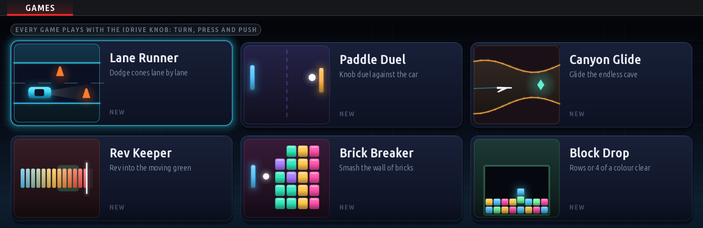
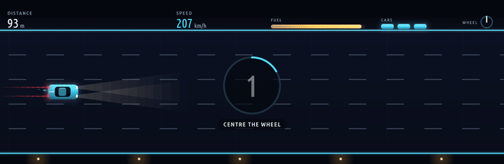
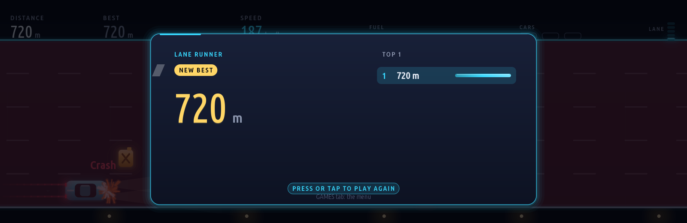
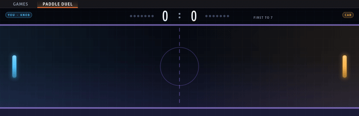
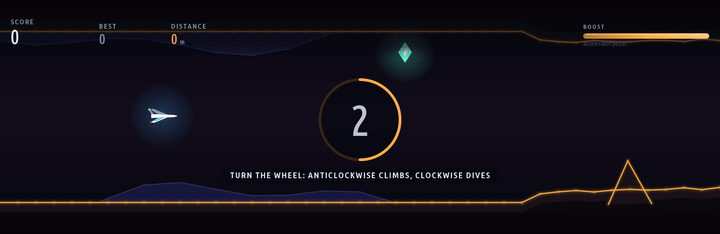
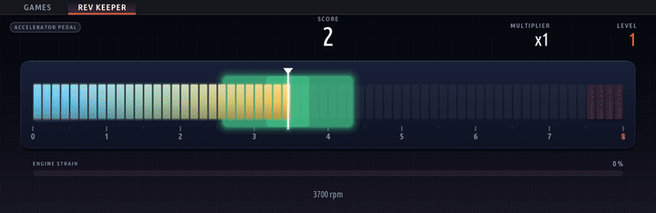
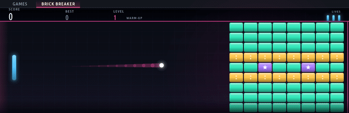
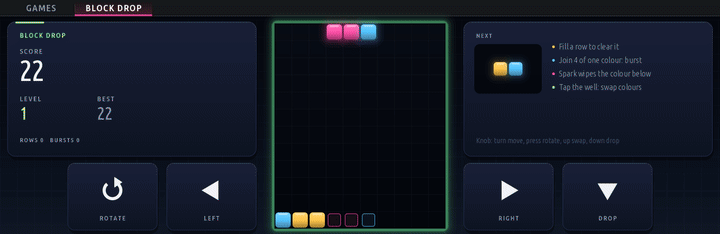
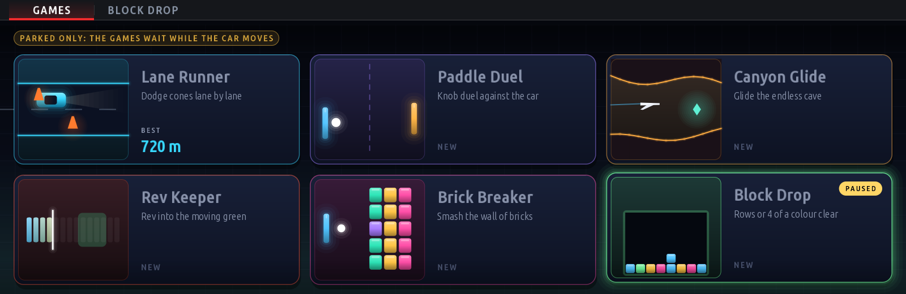

<h1 align="center">Parked Games for BMW iDrive 7</h1>

<p align="center">
  <b>Six original arcade games for the BMW MGU head unit (iDrive 7), all played with the iDrive knob<br>
  (the touchscreen works too). No steering wheel or pedals: the games never read them.</b>
</p>

<p align="center">
  
  
  
  
  
</p>

<p align="center">
  
</p>

Waiting in the car while it charges, or for someone at the shops? **Parked Games** turns the
10.25" centre screen into a small arcade. It is one app with six games, all in one look
("Night Circuit": a deep night-blue backdrop, a glow colour per game, particles and glass
panels), drawn by the car's own GPU renderer at 60 fps. It runs on the car's app platform next
to BMW's apps, keeps your high scores, and pauses by itself the moment the car moves.

> **Disclaimer.** This is an unofficial hobby project. It is not affiliated with, endorsed by or
> supported by BMW AG. Installing it means modifying your own head unit, at your own risk. The
> games are for a parked car only: never play, or let anyone play, while driving.

---

## Contents

- [The menu](#the-menu)
- [The games](#the-games)
- [Safety: parked only](#safety-parked-only)
- [Controls at a glance](#controls-at-a-glance)
- [Try it on your computer](#try-it-on-your-computer)
- [Build and install on the car](#build-and-install-on-the-car)
- [Repository layout](#repository-layout)
- [Making the screenshots and GIFs](#making-the-screenshots-and-gifs)
- [Credits and licence](#credits-and-licence)

---

## The menu

<p align="center">
  
</p>

One tile per game, each with its own little animated scene. Tap a tile, or turn the knob and
press. Your best score shows on the tile once you have one. While a game runs, the header has three tabs: **GAMES** (back here, the round paused), the
game itself, and **SETTINGS**.

---

## The games

### 🏎️ Lane Runner

<p align="center">
  
</p>

An endless night highway. **Change lanes with the knob**, one click a lane (clockwise moves
down, pushing the controller up or down works too), between cones and barriers, and pick up fuel
cans before the tank runs dry. The road gets faster the further you go. Three cars per run; the score is the
distance in metres.

<p align="center">
  <br>
  <sub>Every game ends on the same result card: your score, a <i>New best</i> badge, the top five, and <i>press or tap to play again</i>.</sub>
</p>

### 🏓 Paddle Duel

<p align="center">
  
</p>

You against the car: **turn the knob to move your paddle**, push up or down to slide it. A
second player can take the car's paddle by touching that half of the screen. First to 7 wins;
the high score is the longest rally. Push the controller right before the first serve to play
from the right side instead (remembered).

### 🪂 Canyon Glide

<p align="center">
  
</p>

Fly a glider through an endless cave. **Turn the knob to climb and dive** (clockwise tips the
nose down, and it stays trimmed where you leave it), **press to level out** and **hold the
controller up to boost**. One touch of the rock ends the flight; crystals and distance add to
the score. Taps above or below the glider nudge it too.

### 🔥 Rev Keeper

<p align="center">
  
</p>

Throttle control as a game. **The knob is the throttle**: each click clockwise opens it 4 %,
anticlockwise closes it, and pushing the controller up or down moves it a fifth of the scale at
once. **Hold the needle inside the green zone** while the zone drifts, holds, sweeps and jumps (a
ghost shows where it is about to jump). Staying in builds a multiplier up to ×8; straying builds
engine strain, and at 100 % the engine blows. Every 12 seconds the zone gets narrower and faster.
The engine is only a picture: nothing is sent to the car.

### 🧱 Brick Breaker

<p align="center">
  
</p>

Played sideways for the wide screen: your paddle slides up and down the left edge, a wall of
bricks stands on the right. **Turn the knob or drag a finger** to move the paddle. Green bricks
take one hit, amber two, red three, grey steel never breaks, and purple stars always drop a
power-up: **W** wide paddle, **M** multi-ball, **S** slow ball, **+** extra life. Eight
layouts that come round again, faster each time. Three lives.

### 🟩 Block Drop

<p align="center">
  
</p>

A falling-blocks puzzle with its own rules. Shards of one to three cells, each cell its own
colour, drop into the well. **A full row clears, and so does any group of four or more cells of
one colour.** Cells fall on their own after a clear, so one drop can set off a chain. A white
Spark wipes out the whole colour it lands on, and a fourth colour joins at level 4. Play with the
knob (turn to move, press to rotate, push up to swap colours, push down to drop) or with the
four big buttons beside the well.

---

## Safety: parked only

<p align="center">
  
</p>

The app is built so that it cannot be played on the move. The rule lives in the shell
([`apps/parked_games/vehicle.js`](apps/parked_games/vehicle.js)), so no game can get around it:
the games play only while the car stands still (3 km/h or less). As soon as it moves, the round
pauses, the app drops back to the menu and nothing opens until the car stops again.

The centre screen sits in the driver's view and the iDrive knob is in reach of the driver's seat,
so this stays the case even though the games now use only the knob.

The games read nothing but the car's speed and the iDrive controller: not the steering wheel, not
the pedals, not the gear or the engine. The car's own BACK, MENU and OPTION buttons always stay
with the HMI: BACK leaves the app and the round waits until you come back.

There is no video, no internet and nothing on the driver's cluster or head-up display: the games
only ever draw on the centre screen.

---

## Controls at a glance

Every game is played with the iDrive knob alone; touch is an extra.

| Game | Knob | Controller push | Touch (optional) |
|---|---|---|---|
| Lane Runner | Turn: change lane (one a click) | Up / down: change lane | |
| Paddle Duel | Turn: your paddle | Up / down: slide it. Left / right before the serve: your side | A second player drags on the other half |
| Canyon Glide | Turn: climb / dive (stays trimmed). Press: level out | Hold up: boost | Tap above / below the glider |
| Rev Keeper | Turn: throttle (4 % a click) | Up / down: throttle ±20 % | |
| Brick Breaker | Turn: paddle. Press: launch | Up / down: long move. Right: launch | Drag or tap to place the paddle |
| Block Drop | Turn: move. Press: rotate | Up: swap colours. Down: drop. Left / right: move | Rotate / Left / Right / Drop buttons, tap the well to swap |

**Settings** (the SETTINGS tab): *Parked only* and a *Colour theme*.

---

## Try it on your computer

No car and no BMW software needed. You need **Python 3.6+** and **Node.js 14+**; nothing to
install from npm.

```sh
git clone https://github.com/MaxxxFoka/IDRIVE7GAMES.git
cd IDRIVE7GAMES
python3 kit/tools/build.py --preview-only parked_games   # an offline preview build, no SDK needed
node kit/tools/emu.js parked_games                       # the live emulator: http://localhost:8077
```

The emulator draws every frame with the car's own render engine, compiled to WebAssembly. Click
the tiles, use the mouse wheel or `[` `]` as the knob, `Enter` to press, the arrow keys to push.
Under *Vehicle signals → Manual* you can raise the speed above 3 km/h and watch the games pause. More in
[docs/emulator.md](docs/emulator.md).

Run the tests (every game played headless against the game interface):

```sh
node kit/tools/test_parked_games.js
```

---

## Build and install on the car

> **You need root access to your own head unit**, and BMW's app SDK extracted from it. Neither is
> in this repository or will ever be: the SDK is BMW's copyrighted code. Every `.mgu` package and
> every car kit contains it, so keep them for your own car and never publish them.

The full guide, with backups, the provisioning hook and troubleshooting, is in
[KIT_README.md](KIT_README.md) (sections 2 and 3). In short:

**1. Extract the SDK from your unit** (once):

```sh
scp root@<unit>:'/usr/lib/oap-mainapp/preinstalled_apps/x_call@*.tgz' .
mkdir x_call && tar xzf x_call@*.tgz -C x_call
node kit/tools/extract_sdk.js x_call/javascript/app.js     # writes ./oap-sdk/ (git-ignored)
```

**2. Build and pack the car kit:**

```sh
python3 kit/tools/build.py parked_games        # dist/parked_games@<version>.mgu
deploy/make-car-kit.sh parked_games            # dist/mgu-custom-apps.tar.gz (Windows: deploy\make-car-kit.cmd)
```

**3. Install** with the car parked, ignition on, ideally on a battery charger:

```sh
HU=root@<unit-ip> KEY=~/.ssh/id_mgu deploy/push-to-car.sh check     # read-only: checks the unit first
HU=root@<unit-ip> KEY=~/.ssh/id_mgu deploy/push-to-car.sh install   # backup, install, restart the app platform
```

After one or two minutes **Parked Games** appears under **Apps**. Everything is backed up first;
`deploy/push-to-car.sh restore` puts the unit back to stock. On Windows use
`deploy\push-to-car.ps1`; without a network, copy `dist/mgu-custom-apps/` to a USB stick and run
`sh deploy-car.sh check` and `install` on the unit.

**Status:** the games run in the emulator and the tests; the knob-only controls still want a
round of play on the car.

---

## Repository layout

| Path | What |
|---|---|
| [`apps/parked_games/`](apps/parked_games) | the app: the shell (`main.js`), the safety rules (`vehicle.js`), the look (`style.js`) |
| [`apps/parked_games/games/<id>/`](apps/parked_games/games) | one folder per game; the interface every game follows is [GAMES.md](apps/parked_games/GAMES.md) |
| [`kit/`](kit) | the MGU App Kit: runtime, GPU renderer, build tools, emulator |
| [`deploy/`](deploy) | the scripts that put the apps on the car, and take them off again |
| [`docs/`](docs) | the emulator guide and the media in this README |

Want to add a seventh game? Read [GAMES.md](apps/parked_games/GAMES.md): a game is one folder
with an `index.js`, and the shell finds it by itself. Original designs only.

---

## Making the screenshots and GIFs

Every picture in this README is a real frame from the app, drawn by the kit's renderer, not a
mock-up. They are made offline in about a minute: the built app runs on a stubbed head unit with
a virtual clock, and simple autopilots play each game.

```sh
python3 kit/tools/build.py --preview-only parked_games
node kit/tools/parked_games_media.js          # writes docs/media/parked-games/ (needs ffmpeg)
```

---

## Credits and licence

Parked Games is built on the **MGU App Kit** from
[**cauliflowermossgrape/idrive7-apps**](https://github.com/cauliflowermossgrape/idrive7-apps),
imported at upstream commit `6a269e7` without its reference apps. The kit (runtime, GPU renderer,
emulator, build and install tools) is their work; go and see their apps too. The kit's
original guide is kept here as [KIT_README.md](KIT_README.md).

- Code: [MIT licence](LICENSE). The kit is copyright cauliflowermossgrape and its contributors;
  Parked Games (`apps/parked_games`) is copyright Maksim (MaxxxFoka).
- The GPU renderer and the emulator's draw engine (`kit/renderd`) are **GPL-3.0-or-later**
  (mgu-render, copyright Robert Nisipeanu and IterioDev), see [kit/renderd/LICENSE](kit/renderd/LICENSE)
  and [kit/renderd/README.md](kit/renderd/README.md#licence). The parts taken from the kit's first
  renderer also stay MIT ([LICENSE.mgu-renderd](kit/renderd/LICENSE.mgu-renderd)).
- The vsomeip headers in `kit/renderd/inputgate/vsomeip-include` are **MPL-2.0** (notice in each
  file). The Wayland ivi protocol files carry their own notices.
- The kit's Latin font atlases (`kit/runtime/fonts/{label,bold,num,light,gear}.json`) are baked
  from the Ubuntu font family, under the **Ubuntu Font Licence 1.0**
  ([kit/runtime/fonts/UFL-Ubuntu.txt](kit/runtime/fonts/UFL-Ubuntu.txt)).
- The Noto Sans SC and Noto Sans KR glyphs baked into the kit's fonts are under the **SIL Open Font
  Licence 1.1** ([kit/runtime/fonts/OFL-NotoSansSC.txt](kit/runtime/fonts/OFL-NotoSansSC.txt),
  [kit/localization/fonts/OFL-NotoSansKR.txt](kit/localization/fonts/OFL-NotoSansKR.txt)).
- The six games, their art and every picture in `docs/media/parked-games/` are original and drawn
  in code: no outside art, sounds or game assets.
- Chinese translation notice: [NOTICE.zh-CN.md](NOTICE.zh-CN.md).
- BMW, iDrive and the BMW logo are trademarks of BMW AG, used here only to say which cars this
  runs on.

**Not in this repository, on purpose.** BMW's app SDK (`oap-sdk/`, extracted from your own head
unit with `kit/tools/extract_sdk.js`), built packages (`dist/`, `*.mgu`, `*.tgz`, which contain
that SDK), SSH keys and enrolment folders, and anything that identifies a car (VIN, captures, logs)
must never be committed. `.gitignore` keeps them out; please don't force-add them.

The kit's translated BMW fault texts (`kit/localization/diagnostic-*`, used only by upstream's
`dtc_scanner` app, which isn't in this repo) are left out too; get them from upstream if you need them.
